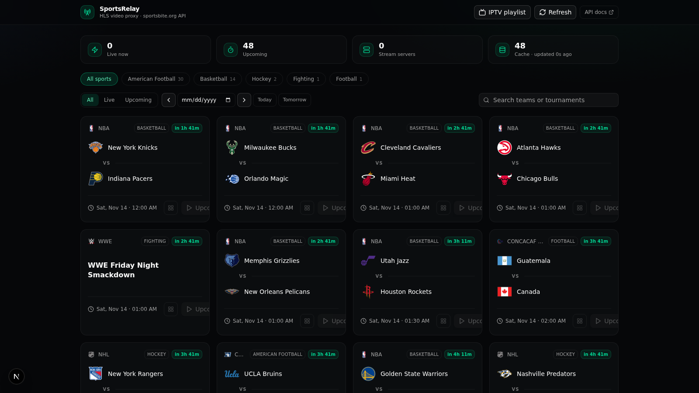

<div align="center">

# SportsRelay

**A modern HLS video proxy and IPTV gateway for the
[sportsbite.org](https://sportsbite.org/api) public sports API.**

Point it at an event and SportsRelay does the rest: cached schedule relay,
fully rewritten HLS manifests, streamed segments — playable in any browser,
in a 2/4-up multiview grid, or through IPTV players via a dynamic M3U
playlist.




</div>

## Highlights

- **Zero-drama playback** — one URL per stream (`/api/hls/play/{streamId}`)
  serves a fully rewritten master playlist; hand it to hls.js, Safari or VLC
  and hit play.
- **IPTV-ready** — a dynamic `playlist.m3u8` regenerates on every request so
  TiviMate, IPTV Smarters, Kodi, Jellyfin and friends see every event as a
  channel that streams through your relay.
- **Multiview** — watch up to 4 events at once in a 1×2 or 2×2 grid; panes
  fill the viewport on desktop, chrome auto-fades while you watch, and one
  pane owns the audio.
- **Kind to the upstream API** — shared 60s cache, ETag revalidation and
  stale-on-error fallback mean dozens of viewers cost the upstream one
  request per minute.
- **Non-open proxy** — strict HTTPS hostname allowlist, extendable via env
  var; segments flow from the signed CDN, never through third parties you
  did not allow.
- **Ship it** — multi-stage Docker build, minimal non-root runtime image,
  built-in `HEALTHCHECK`, compose file with resource limits.

## Table of contents

- [How it works](#how-it-works)
- [Quick start](#quick-start)
- [Local development](#local-development)
- [Using IPTV players](#using-iptv-players)
- [Multiview](#multiview)
- [Configuration](#configuration)
- [API endpoints](#api-endpoints)
- [Rate-limit safety](#rate-limit-safety)
- [Disclaimer](#disclaimer)

## How it works

```
Browser ──▶ /api/schedule ──────▶ sportsbite.org/api/schedule   (cached 60s)
        ──▶ /api/hls/play/{id} ─▶ embed.sportsbite.org/selfhost/play/{id}
                                   └─ rewritten master playlist
        ──▶ /api/hls?u=… ───────▶ variant + media playlists (rewritten)
        ──▶ /api/hls?u=… ───────▶ TS segments (r2 CDN URL, streamed)

IPTV player ─▶ /playlist.m3u8 ─▶ generated channel list,
             then per-channel ─▶ /api/hls/play/{id} …
```

SportsBite embeds its player source as base64 and signs segments with
`#r2=` fragments pointing at a rotating CDN. SportsRelay decodes all of it
and rewrites **every** URI in **every** playlist level — variants, segments,
`EXT-X-KEY`/`EXT-X-MAP`/`EXT-X-MEDIA` — so the player only ever talks to your
server. Expired segments are never replayed: playlists are proxied live, and
segment requests stream straight from the CDN with `Range` support and an
automatic origin fallback.

## Quick start

```bash
docker compose up -d --build

# Open http://localhost:3000
```

Or plain Docker:

```bash
docker build -t sportsrelay .
docker run -d --name sportsrelay -p 3000:3000 --restart unless-stopped sportsrelay
```

The image:

- runs the Next.js **standalone** output on Node 22 Alpine (~150 MB),
- executes as an unprivileged user,
- exposes a `HEALTHCHECK` hitting `/api/health`,
- honours `PORT` and `HLS_EXTRA_ALLOWED_HOSTS`.

### Health checks

| Probe | Meaning |
| --- | --- |
| `GET /api/health` | Fast liveness — no upstream calls, always cheap |
| `GET /api/health?deep=1` | Also pings the schedule upstream |

## Local development

```bash
bun install
bun run dev          # http://localhost:3000
bun run lint
```

## Using IPTV players

Point any IPTV player at the dynamic playlist:

```text
http://localhost:3000/playlist.m3u8
http://localhost:3000/playlist.m3u8?sport=football&status=live
http://localhost:3000/playlist.m3u8?servers=all&limit=500
```

The playlist is **regenerated on every request** — as fixtures go live the
channels rename to `[LIVE] Team A vs Team B`, finished fixtures drop out, and
every channel URL points back at this relay (never upstream).

| Parameter | Default | Purpose |
| --- | --- | --- |
| `sport` | — | Only include one sport slug (e.g. `football`, `basketball`) |
| `date` | — | Only include a specific day, `YYYY-MM-DD` |
| `status` | `all` | `all` (live first, then upcoming), `live`, or `upcoming` |
| `limit` | `300` | Max events included, 1–1000 |
| `servers` | `first` | `first` = one channel per event; `all` = one channel per stream server (` · Server 2` suffix) |

Channels carry `tvg-id`, `tvg-name`, `tvg-logo` (relayed through `/api/img`)
and `group-title` (sport name); line endings are CRLF for maximum player
compatibility.

> Copying the playlist URL from the dashboard works over plain HTTP too —
> the copy buttons fall back to `document.execCommand` when the async
> Clipboard API is unavailable outside HTTPS.

## Multiview

Add events with the **+ Multi** button on any card, then open the floating
tray. Three layout styles:

| Layout | Capacity | Desktop behaviour |
| --- | --- | --- |
| Rows | 2 | Two stacked panes, each exactly half the viewport |
| Columns | 2 | Two panes side by side |
| Grid | 4 | 2×2 grid |

- Panes fill the viewport height on desktop — no scrolling to see the second
  stream; mobile keeps the familiar scrollable card layout.
- Title bars and per-tile controls fade while the mouse is away and return
  on movement; the header bar fades after ~2.5s of mouse rest (keyboard
  focus still reveals it).
- Click a pane's speaker icon to give it the audio — all other panes stay
  muted.

## Configuration

| Variable | Default | Purpose |
| --- | --- | --- |
| `PORT` | `3000` | HTTP port inside the container |
| `HLS_EXTRA_ALLOWED_HOSTS` | — | Comma-separated extra upstream hosts the HLS relay may fetch from |
| `SCHEDULE_CACHE_TTL_MS` | `60000` | Schedule cache TTL (5s–600s) |
| `PLAYLIST_BASE_URL` | auto-detected | Absolute base URL written into `/playlist.m3u8` entries (set it if the auto-detection behind a reverse proxy guesses wrong) |

Copy `.env.example` to `.env` to use them with Compose.

## API endpoints

| Endpoint | Description |
| --- | --- |
| `GET /api/health` | Container health probe (`?deep=1` pings upstream) |
| `GET /playlist.m3u8` | Dynamic IPTV playlist (`sport`, `date`, `status`, `limit`, `servers`) |
| `GET /api/schedule` | Cached schedule relay (`sport`, `date`, `status`, `page`, `limit`) |
| `GET /api/hls/play/{streamId}` | Rewritten master playlist for a stream server |
| `GET /api/hls?u={base64url}` | Universal HLS relay: playlists rewritten, segments streamed |
| `GET /api/img?u={base64url}` | Image relay for team/tournament logos |

## Rate-limit safety

The upstream API allows 60 requests/minute/IP. All visitors share the server
cache (60s TTL), and segment traffic flows through the signed CDN rather than
the schedule API, so the relay effectively never trips the limit.

## Disclaimer

Unofficial viewer for the public
[sportsbite.org API](https://sportsbite.org/api). Not affiliated with
sportsbite.org. Match data, teams and streams belong to their respective
owners. This proxy adds no access to any content that is not already
publicly served — respect the upstream terms of service and use it for
personal viewing only.
